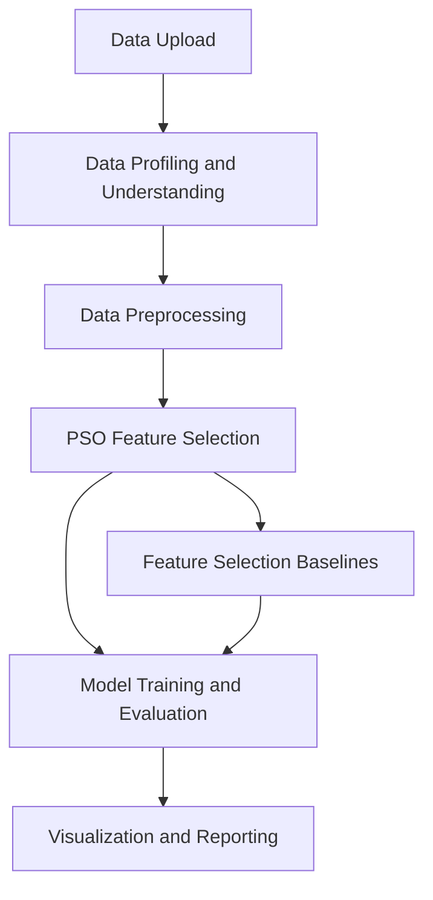
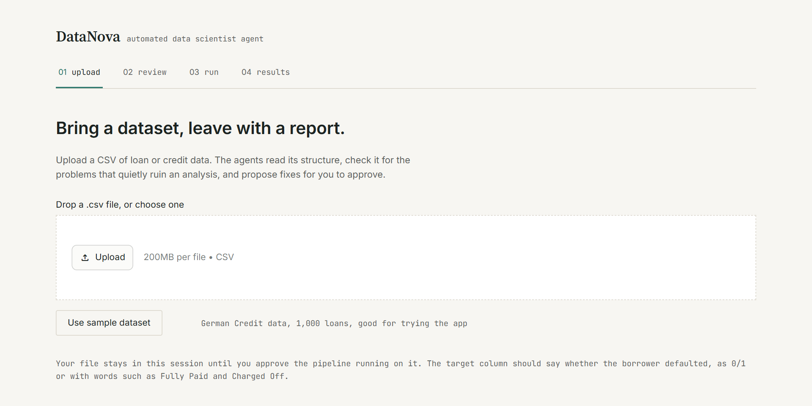
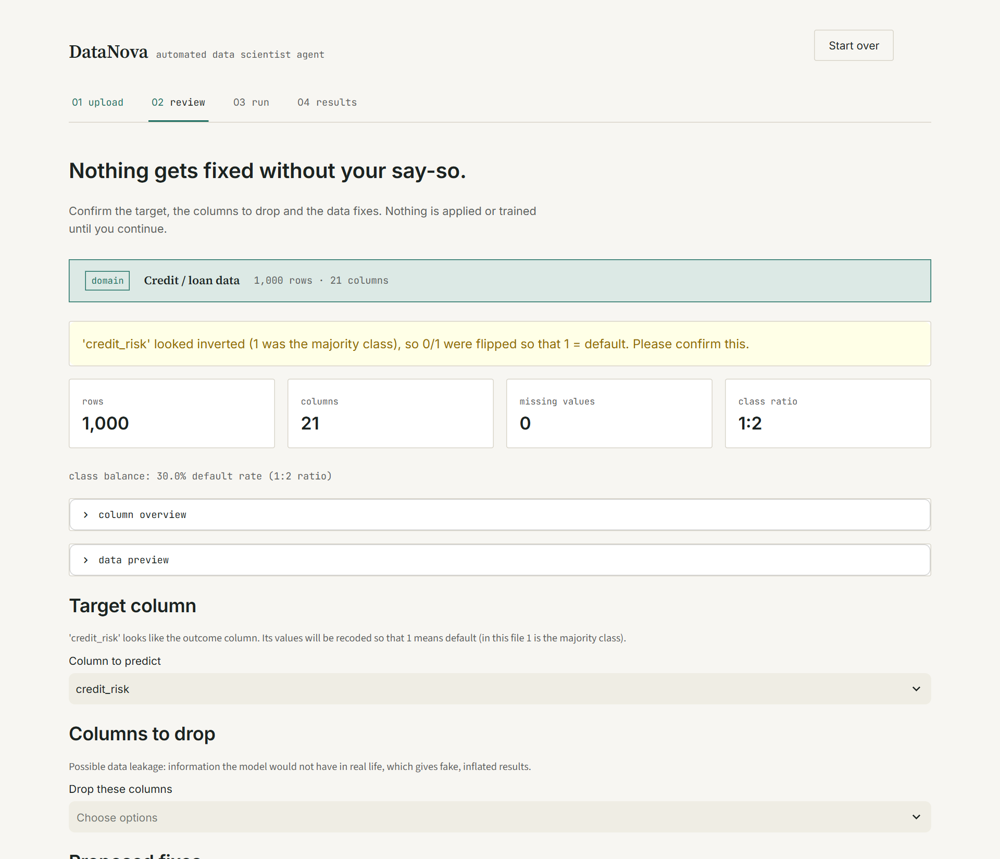
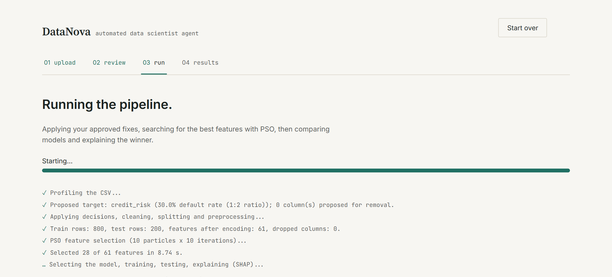
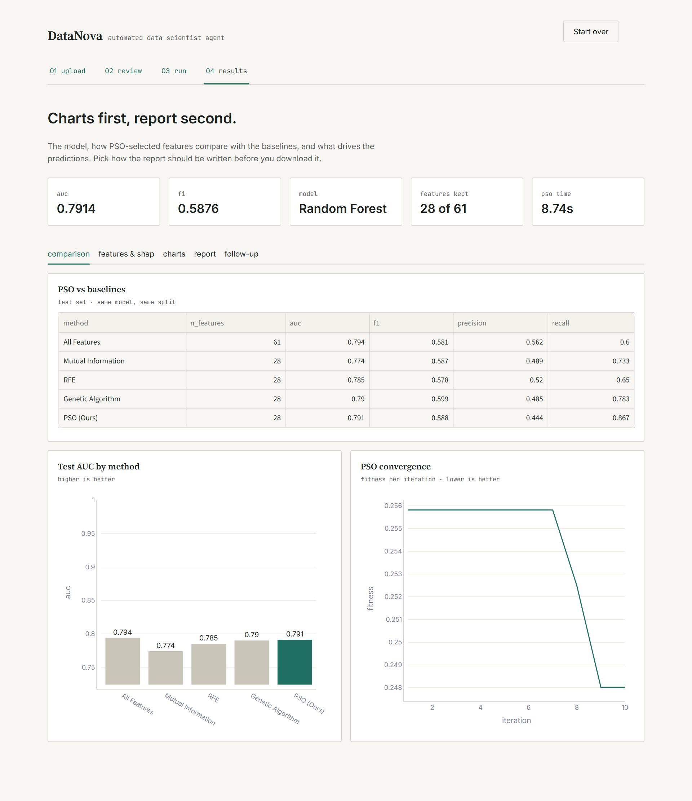
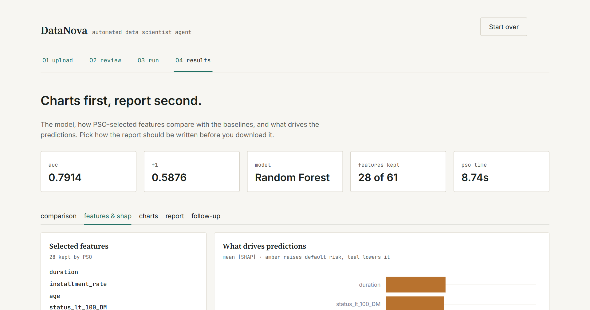
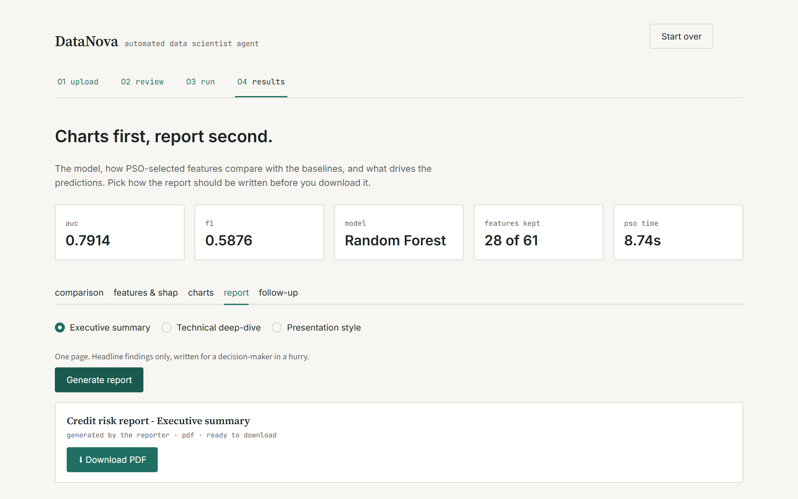

# DataNova — Automated Data Scientist Agent

An automated data science pipeline designed to streamline data understanding, preprocessing, feature selection, predictive modeling, visualization, and reporting.

## Overview

Data science workflows often involve several time-consuming steps, from inspecting raw data and addressing quality issues to selecting relevant features and evaluating machine learning models.

**DataNova** brings these steps together in an agent-based workflow to make data analysis more structured and efficient. The project includes a credit-risk modeling workflow and a Particle Swarm Optimization (PSO) feature-selection component.

## Key Features

- **Data Profiling:** Inspect dataset structure, data types, missing values, and potential quality issues.
- **Data Preprocessing:** Prepare data for machine learning through appropriate preprocessing and train-test splitting.
- **Exploratory Data Analysis:** Generate visualizations to understand the dataset.
- **PSO-Based Feature Selection:** Apply Binary Particle Swarm Optimization to search for useful feature subsets.
- **Baseline Comparisons:** Compare PSO with Mutual Information, Recursive Feature Elimination (RFE), and a Genetic Algorithm.
- **Predictive Modeling:** Train and evaluate machine learning models.
- **Reporting and Visualization:** Present analytical results, model comparisons, and visual insights.
- **Interactive Application:** Provide a user interface for interacting with the analysis workflow.

## System Architecture



The pipeline combines data preparation, optimization-based feature selection, predictive modeling, and reporting in a modular workflow. The PSO component searches for a compact feature subset, which is evaluated alongside baseline selection methods.  

## My Contribution: PSO Feature Selection

My primary contribution focused on the feature-selection component of DataNova.

I implemented a **Binary Particle Swarm Optimization (PSO)** approach for selecting relevant features in a credit-risk prediction workflow.

### How it works

1. Represent each particle as a binary feature-selection mask, where `1` means a feature is selected and `0` means it is excluded.
2. Evaluate feature subsets using stratified cross-validation and ROC-AUC.
3. Penalize unnecessarily large feature subsets to balance predictive performance and model simplicity.
4. Compare PSO-selected features with baseline methods, including Mutual Information, RFE, and a Genetic Algorithm.
5. Run experiments across different random seeds and penalty values to examine feature-selection behavior.

The fitness function is:

`Fitness = (1 - Mean CV AUC) + λ × (Selected Features / Total Features)`

The objective is to minimize this fitness score. The penalty parameter λ controls the trade-off between predictive performance and the number of selected features.

This work gave me practical experience with optimization algorithms, feature engineering, cross-validation, and experimental evaluation.

## Technology Stack

- **Language:** Python
- **Data Processing:** Pandas, NumPy
- **Machine Learning:** Scikit-learn
- **Optimization:** PySwarms and a custom Genetic Algorithm implementation
- **Application:** Streamlit, where used by the application
- **Workflow and Integration:** Modular Python pipeline

## Project Structure

```text
DataNova-Automated-Data-Scientist/
├── app.py
├── pipeline.py
├── pipeline_adapter.py
├── profiler.py
├── data_understanding.py
├── data_prep.py
├── pso_feature_selection.py
├── modeling.py
├── reporter.py
├── chat_followup.py
├── domain_classifier.py
├── fix_proposer.py
├── scoring.py
├── requirements.txt
├── data/
├── experiments/
├── screenshots/
├── test_pipeline.py
├── test_modeling.py
├── test_data_prep.py
├── README.md
├── README_BACKEND.md
└── README_RUN.md
```

## Getting Started

### 1. Clone the repository

```bash
git clone https://github.com/kritika162004/DataNova-Automated-Data-Scientist.git
cd DataNova-Automated-Data-Scientist
```

### 2. Create a virtual environment

```bash
python -m venv .venv
```

Activate it on Windows PowerShell:

```powershell
.\.venv\Scripts\Activate.ps1
```

### 3. Install dependencies

```bash
python -m pip install --upgrade pip
pip install -r requirements.txt
```

### 4. Configure the API key, if required

If the application uses the Groq API, configure your API key through a local `.env` file or the configuration method specified in the project documentation.

Never commit real API keys, passwords, or other credentials to GitHub.

### 5. Run the application

Consult `README_RUN.md` for the project's exact execution instructions. If the application entry point is configured for Streamlit, the command may be:

```bash
streamlit run app.py
```

## Experiments and Evaluation

The repository includes experiment scripts and result files for examining model and feature-selection behavior.

Evaluation should use the recorded outputs produced by the actual experiments. Predictive performance, runtime, and feature reduction can vary with the dataset, model configuration, random seed, and penalty parameter.

## Learning Outcomes

Working on DataNova helped me strengthen my understanding of:

- Python-based data science workflows
- Data preprocessing and feature engineering
- Binary Particle Swarm Optimization
- Cross-validation and ROC-AUC-based evaluation
- Comparing feature-selection algorithms
- Reproducible experiments and modular project development

## Project Context

DataNova was developed as a collaborative project, with responsibilities divided across data understanding, feature selection, modeling, and application integration. This repository presents the project code and my contribution to its PSO feature-selection component.

## License

No license has been specified yet. Please check the project's ownership and licensing requirements before selecting one.
---

## Application Screenshots

### 1. Data Upload Interface


### 2. Data Review Interface


### 3. Pipeline Execution


### 4. Model Comparison


### 5. SHAP Explainability


### 6. Generated Report

